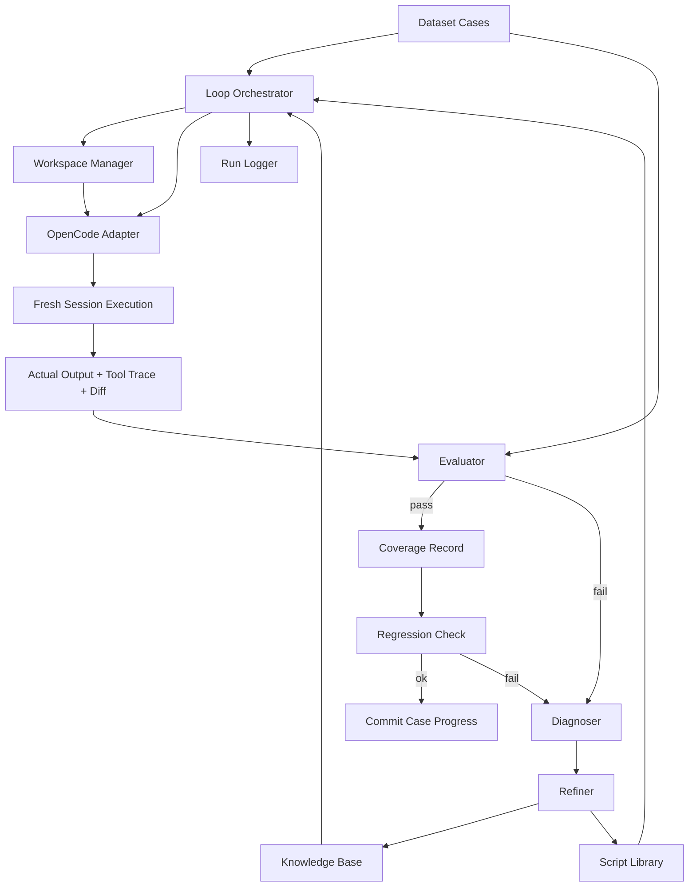
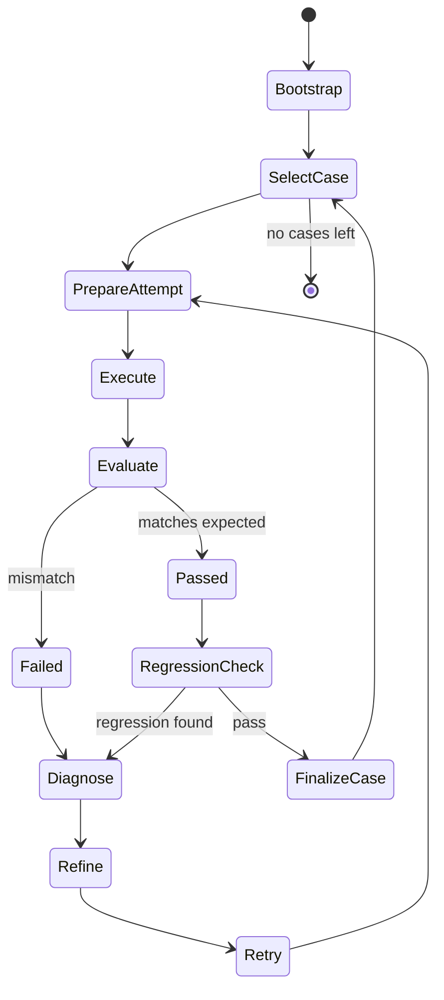

# Auto Evolution Spec

## 1. Summary

This project will add an external-orchestrated "experience refinement" workflow on top of OpenCode.

The core idea is:

1. We maintain a dataset of `material -> expected_result` pairs.
2. We maintain an evolving knowledge base whose primary persistent target is `knowledge/expert_rules.md`.
3. We first call OpenCode itself to generate or refresh that expert experience file from labeled examples.
4. For each dataset item, we then ask a fresh OpenCode solve round to read the current expert experience and produce the final answer.
5. We compare the actual output against the expected result.
6. If the output does not match, we run a separate OpenCode refinement round that reads the failure context and updates `knowledge/expert_rules.md`.
7. We repeat until the case passes or the retry budget is exhausted.

This is not true gradient backpropagation. It is an iterative, evaluation-driven refinement loop.

## 2. Product Goal

Build a system that can gradually improve task performance across a dataset by refining:

- expert knowledge prompts
- reusable script assets
- structured execution rules

while using OpenCode as the execution engine for each attempt.

## 3. Design Principle

Treat OpenCode as a controllable execution engine, not as the entire learning system.

The outer system is responsible for:

- sample scheduling
- workspace/session isolation
- execution request construction
- result evaluation
- failure diagnosis
- knowledge refinement
- regression checking

OpenCode is responsible for:

- running an agent with a chosen model
- using tools and scripts
- producing outputs, traces, and file changes
- exposing session, message, tool, and diff data

## 4. In Scope

- A dataset-driven iteration loop
- A project-local knowledge base
- A project-local spec, run log, and experiment structure
- Fresh-session execution per case
- Case-by-case evaluation
- Controlled refinement of expert experience text
- Later, controlled refinement of selected scripts
- Use of existing OpenCode sessions, tools, worktrees, and diffs

## 5. Out of Scope For MVP

- True runtime checkpointing of Python/global memory
- Line-by-line debugger interception
- True differentiable optimization
- Automatic unrestricted code rewriting across the repo
- Full container orchestration
- Fully autonomous long-horizon self-improvement without guardrails

## 6. Target Outcome

After feeding a batch of `material -> expected_result` pairs, the system should:

- bootstrap an initial expert experience file by calling OpenCode itself
- execute each case with a fresh solve context that reads the current expert experience
- detect mismatches
- refine the expert experience file when needed
- verify that refinements do not obviously break previous passing cases
- produce an auditable history of what changed and why

## 7. System Overview



## 8. Core Concepts

### 8.1 Case

A case is one training/evaluation unit.

Required fields:

- `id`
- `material`
- `expected_result`
- `compare_rule`

Optional fields:

- `tags`
- `notes`
- `difficulty`
- `allowed_tools`
- `preferred_agent`
- `preferred_model`

### 8.2 Knowledge Base

The knowledge base is the evolving "expert memory" consumed by each fresh execution.

Recommended initial structure:

- `knowledge/expert_rules.md`
- `knowledge/patterns.yaml`
- `knowledge/failure_notes.md`
- `knowledge/change_log.md`

### 8.3 Script Library

Reusable scripts, templates, or helper assets that the agent may rely on.

Recommended structure:

- `scripts/transformers/`
- `scripts/parsers/`
- `scripts/validators/`
- `scripts/templates/`

### 8.4 Attempt

A single run of one case under one knowledge version.

Each attempt must be logged with:

- case id
- attempt id
- workspace id or directory
- session id
- knowledge version
- script version
- result summary
- evaluation result

### 8.5 Refinement

A targeted modification proposed after a failed attempt.

Refinements should be classified:

- knowledge-only refinement
- script-level refinement
- environment issue
- unsupported-model issue
- evaluator issue

## 9. Execution Model

Each phase runs in its own fresh OpenCode session.

The workflow has two main loops:

1. Bootstrap loop
   - attach labeled examples
   - call OpenCode to generate or refresh `knowledge/expert_rules.md`
2. Case loop
   - solve round: fresh OpenCode execution reads `knowledge/expert_rules.md` and the current material
   - evaluate the result against the expected output
   - if failed, run a separate refine round that updates `knowledge/expert_rules.md`
   - retry the solve round with the refined experience until pass or retry budget exhaustion

Important constraint:

The system should avoid accumulating hidden conversational state across cases.

That means each case attempt should use a fresh session or a tightly controlled fork, not a long-running mixed-memory conversation.

## 10. How OpenCode Will Be Used

This system is intentionally designed around existing OpenCode control points.

### 10.1 Session Control

We will rely on:

- session create
- session prompt
- session fork
- session abort
- session messages
- session diff
- session revert

### 10.2 Message Construction

Each execution request can specify:

- agent
- model
- system text
- parts
- structured format
- variant

This is sufficient for controlled case execution.

### 10.3 Workspace Isolation

We will use worktree/workspace isolation to keep attempts separated.

Desired behavior:

- each attempt gets a clean working context
- resulting changes can be diffed
- cleanup/reset can happen between attempts

### 10.4 Observability

We will consume:

- message updates
- message part updates
- session status
- tool failures
- file diffs

This lets the outer loop reason about execution quality.

## 11. Proposed Project Structure

Recommended new project-local structure:

```text
AUTO_EVOLUTION_SPEC.md
auto-evolve/
  dataset/
    cases/
      case-001/
        material/
        expected/
        compare.yaml
  knowledge/
    expert_rules.md
    patterns.yaml
    failure_notes.md
    change_log.md
  scripts/
    transformers/
    parsers/
    validators/
    templates/
  orchestrator/
    bootstrap.ts
    case-runner.ts
    evaluator.ts
    diagnoser.ts
    refiner.ts
    regression.ts
    workspace.ts
    opencode.ts
    loop.ts
  runs/
    .gitkeep
```

## 12. Data Contracts

### 12.1 Case Spec

Suggested case schema:

```json
{
  "id": "case-001",
  "material_path": "dataset/cases/case-001/material/input.json",
  "expected_path": "dataset/cases/case-001/expected/output.json",
  "compare_rule": {
    "mode": "json_exact"
  },
  "tags": ["baseline"]
}
```

### 12.2 Attempt Record

Suggested attempt schema:

```json
{
  "attempt_id": "attempt-001",
  "case_id": "case-001",
  "knowledge_version": "kv-0012",
  "workspace": "workspace-abc",
  "session_id": "session-xyz",
  "status": "failed",
  "evaluation_path": "runs/run-001/evaluation.json",
  "diff_path": "runs/run-001/diff.json"
}
```

### 12.3 Evaluation Result

Suggested evaluation schema:

```json
{
  "passed": false,
  "score": 0.67,
  "mismatches": [
    {
      "type": "missing_field",
      "path": "items[2].price"
    }
  ],
  "tool_failures": [
    {
      "tool": "bash",
      "kind": "nonzero_exit"
    }
  ],
  "summary": "Price field missing on one item."
}
```

## 13. Loop State Machine



## 14. Bootstrap Phase

The first phase generates the initial expert knowledge.

Input:

- one or more early cases
- their materials
- their expected results

Output:

- first version of `expert_rules.md`
- initial `patterns.yaml`
- initial assumptions recorded in `failure_notes.md`

Bootstrap should be explicit and auditable.

The system should store:

- which cases were used for bootstrap
- what expert rules were inferred
- what assumptions were introduced

## 15. Per-Case Execution Flow

For each case:

1. Load current knowledge base.
2. Assemble execution prompt.
3. Reference reusable scripts if needed.
4. Send request to OpenCode with explicit agent and model.
5. Wait for completion or failure.
6. Collect:
   - final answer
   - tool failures
   - file diff
   - message transcript summary
7. Run evaluator.

## 16. Evaluation Strategy

Evaluation must be pluggable.

Supported modes should eventually include:

- exact text match
- normalized text match
- JSON exact match
- JSON field-aware match
- CSV row/column comparison
- file diff threshold
- custom evaluator script

MVP should support:

- text
- JSON
- file diff summary

## 17. Refinement Strategy

Refinement must be conservative.

### 17.1 MVP Rule

Only update expert knowledge text.

Do not auto-edit core scripts in the first implementation.

Reason:

- knowledge edits are cheaper
- lower risk of breaking the project
- easier to audit
- easier to revert

### 17.2 Later Expansion

Allow limited script refinement only when:

- failure persists after knowledge refinement
- target file is inside approved script directories
- proposed patch is small and explainable
- regression checks are mandatory afterward

## 18. Regression Policy

A newly passing case is not enough.

Every accepted refinement should be checked against prior passing cases.

Regression policy for MVP:

- after each accepted refinement, rerun a small rolling subset of previous passing cases

Regression policy for later phases:

- rerun all critical cases
- use tag-based regression subsets

## 19. Workspace and Cleanliness Policy

Each attempt should prefer an isolated workspace.

Desired guarantees:

- no accidental carry-over from previous failed attempts
- file changes remain attributable to one attempt
- cleanup is straightforward

Current assumption:

- worktree isolation will be the first implementation path
- stronger self-cleaning may be layered later

## 20. Logging and Auditability

Every attempt should emit durable logs.

Minimum artifacts:

- input case reference
- knowledge version
- prompt payload summary
- selected agent/model
- session id
- final output snapshot
- tool failure summary
- diff summary
- evaluation result
- refinement proposal
- accepted change record

These logs are critical because this system is iterative and may otherwise become impossible to debug.

## 21. Safety and Control Rules

The system must not freely rewrite the repo without boundaries.

Required controls:

- refinement scope restrictions
- allowed directories for script mutation
- attempt retry limit
- regression checks before accepting changes
- explicit records of each accepted refinement

Initial safe defaults:

- knowledge files: writable
- orchestrator files: writable by developer-controlled flow only
- core OpenCode internals: not automatically mutated by the loop

## 22. MVP Definition

The MVP is successful if it can:

1. Read a small dataset of cases.
2. Bootstrap an initial `expert_rules.md`.
3. Execute each case via OpenCode in a fresh session.
4. Compare actual and expected result.
5. Refine `expert_rules.md` when a case fails.
6. Retry the case.
7. Persist logs and attempt records.

The MVP does not need:

- automatic script mutation
- parallel search
- advanced tracing
- containerized infrastructure

## 23. Phase Plan

### Phase 1: Spec and Scaffolding

- add this spec
- create project directories
- define case schema
- define run artifact schema

### Phase 2: Bootstrap + Single Case Runner

- load one case
- build prompt payload
- call OpenCode once
- save result

### Phase 3: Evaluator + Retry Loop

- add evaluator
- add failure diagnosis
- add expert rule refinement
- rerun failed case

### Phase 4: Multi-Case Sequential Loop

- iterate through all cases
- track pass/fail coverage
- save per-case histories

### Phase 5: Regression Check

- rerun prior passing cases after accepted refinements

### Phase 6: Controlled Script Refinement

- only for approved directories
- only with small targeted patches

## 24. Open Questions

These need to be answered before implementation hardens:

- What is the canonical case format?
- What compare modes are mandatory in phase 1?
- Should knowledge be one large file or multiple modular files?
- Which directories are allowed for automatic script edits?
- Which agent/model should be the default executor?
- How many retries per case are allowed before the case is marked unresolved?

## 25. Recommended Initial Decisions

To reduce ambiguity, the first implementation should assume:

- dataset format: JSON metadata + material/expected files
- default evaluator: JSON exact or normalized text
- default executor agent: `build`
- default knowledge mutation target: `auto-evolve/knowledge/expert_rules.md`
- max retries per case: 3
- regression subset size: 3 recent passing cases

## 26. Final Position

This system should be built as a project-local orchestration layer inside this repository.

It should not attempt to turn OpenCode itself into a self-training monolith.

Instead:

- OpenCode remains the execution substrate
- the outer loop owns learning logic
- the knowledge base evolves through explicit, auditable iterations

That architecture is the simplest path that is both implementable and controllable.
