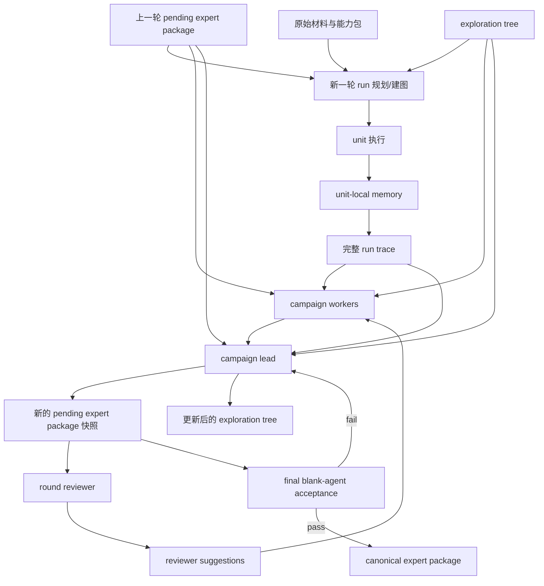

# 2026-04-14 Campaign智能体、待推送专家经验区与探索树重构计划

## 目标

把当前 long-task / campaign 体系，从“run 产出局部记录，campaign 做聚合和晋升”的模式，重构成下面这种更稳定的形态：

- `unit` 负责执行和保存局部记忆
- `run` 负责完成一轮探索，并留下完整运行轨迹
- `campaign` 作为真正的跨 run 智能体存在，读取历轮运行过程并主动维护专家经验
- `待推送专家经验区` 作为 blank agent 唯一可见的专家经验输入面，并且与最终正式专家经验区同构
- `exploration tree` 作为跨 run 维护的外部探索地图
- 每轮 `reviewer` 只给建议，不裁决、不改内容
- 最终只有 blank-agent 硬验收决定能否晋升为正式专家经验

本计划是设计方案，也是后续实现与测试的执行蓝图。

## 复用原则

这次设计默认尽可能复用现有模块，不另起一套新世界。

1. 复用现有 `long-task runner`，继续负责 run 内图执行、重试、replan、validator 调用。
2. 复用现有 `long-task repository`，继续负责 unit 和 run 级证据持久化。
3. 复用现有 `long-task-campaign runner / repository`，但把它们从“聚合程序”升级成真正的 campaign 工作面。
4. 复用现有 `acceptance framework` 和 blank-agent deployment harness，不重写验收引擎。
5. 复用现有 `expert-workspace` 结构，把 `pending expert package` 设计成它的同构快照，而不是另外设计一种包格式。

一句话：

**保留执行骨架，重构职责边界、共享数据面和跨 run 记忆方式。**

## 当前设计的核心问题

1. `campaign` 现在更像晋升程序，不像真正的跨 run 智能体。
2. 当前沉淀的大量内容更像证据仓库，不像 blank agent 真能直接消费的专家经验。
3. 成功经验和失败经验被记住了，但常常不能稳定传入下一轮默认输入面。
4. 共同经验包建得太晚，前面很多节点明明学到了东西，后面节点却不能充分复用。
5. 缺少独立于 run 图的 `exploration tree`，无法稳定记录整个解空间探索到了哪里。
6. 评审和经验写作边界还不够硬，容易再次混成“后层帮前层写经验”。
7. 待推送专家经验区的 `surface_contract`、结构检查、deployment 输入规则还不是同一个规则源，容易出现前面判合法、后面却因缺少某个硬编码文件而崩溃。
8. 文档类任务没有明确的“只允许无界面执行”安全规则，导致 agent 虽然不一定会改错外部文件，但仍可能走偏去打开 Word、Excel 或资源管理器。

## 统一规则源

这一轮重构必须新增一条高优先级原则：

**待推送专家经验区自己的 `surface_contract` 必须成为唯一正式规则源。**

具体含义：

- `workspace-layout` 结构检查只能依据当前 package 的 `surface_contract`
- `round reviewer` 解释 package 时也只能依据当前 package 的 `surface_contract`
- `blank-agent final acceptance` 读取 package 时也只能依据当前 package 的 `surface_contract`
- 不能在 deployment spec、validator 配置或其他外部位置再偷偷硬编码一套“必须存在某个叶子文件”的额外规则

对于 `initialExpertContextPaths` 这类字段：

- 它们只应作为**建议入口**或**优先阅读入口**
- 不应再作为“缺少某个叶子文件就直接崩溃”的硬前置条件
- 真正的正式解释入口应来自：`pending expert package root + surface_contract`

也就是说：

**结构检查、review、最终空白 Agent 验收，必须都站在同一份 package contract 上说话。**

## 无界面执行安全

文档、表格、模板类任务必须默认遵守：

**只允许无界面执行（headless-only）**

具体要求：

- 只允许脚本、CLI、OpenXML、后台处理
- 不允许启动 Word、Excel、资源管理器或其他桌面 GUI 程序
- 不允许通过 `Start-Process`、`Invoke-Item`、文件关联打开等方式间接拉起 GUI
- 如果能力包加载失败，应优先走能力包自身的 CLI / 脚本入口，而不是退回 GUI 操作

这条规则不是任务策略，而是平台级执行安全约束。

## 核心对象

### 1. `unit-local memory`

每个 unit 自己维护的局部记忆。

内容包括：

- 局部观察
- 局部失败
- 当前假设
- 草稿映射
- 本 unit 试过的路径
- 本 unit 的自检结果

特点：

- 只服务当前 unit 和最终 run trace
- 不直接作为 blank agent 输入
- 可以很局部、很临时

### 2. `run trace`

每一轮 run 结束后形成的一份完整运行轨迹。

这里不能是略过式摘要，必须是完整轨迹。

内容至少包括：

- 图和节点执行过程
- 每个 unit 的完整局部记忆汇总
- 所有执行路径
- 每条路径的执行结果
- 遇到的错误
- 哪些命令成功执行
- 哪些命令失败
- 哪些脚本入口可用
- 哪些脚本入口不可用
- 每轮关键成功路径
- 每轮关键失败路径
- 本轮主要 blocker
- 本轮探索到的解空间区域
- 本轮对待推送专家经验区的影响建议

特点：

- 它是 campaign 的主要原始输入
- 它记录“这一轮到底发生了什么”
- 它不是 blank agent 要读的专家经验

### 3. `pending expert package`

待推送专家经验区。

这是整个新设计的核心。

定义：

- 它的结构必须和最终正式专家经验区同构
- 它必须始终保持 blank agent 可直接消费
- blank agent 只能读它，不能读 campaign memory、run trace、failure packets 等内部材料

它不是：

- 一堆 lessons 汇总
- 一堆 reviewer 意见
- 一份分析报告

它必须是真正的专家经验包，内容应包括但不限于：

- 任务入口
- 规则
- 输出契约
- 执行流程
- 数据勾稽方式
- 具体数字计算逻辑
- 表格怎么填写
- 字段怎么找到
- 模板填写方法
- 失败路径约束
- 工具使用方法

### 4. `campaign memory`

这是 campaign 自己的内部跨 run 记忆。

内容包括：

- 历轮 run 的抽象总结
- reviewer 建议
- 高置信失败模式
- 高置信成功模式
- 历轮 package 变化摘要
- 历轮 exploration tree 变化摘要

特点：

- 只给 campaign 自己用
- 不直接喂给新的 run
- 不直接暴露给 blank agent

### 5. `exploration tree`

跨 run 外置维护的探索树。

作用：

- 表示整个解空间已经探索了哪些区域
- 哪些区域是强失败、弱失败、可疑成功、稳定成功
- 哪些路径曾经探索过但可能值得重试

它应该是“地图”，不是“法律”。

也就是说：

- 新 run 可以看到它
- 它帮助新 run 理解现在解空间探索到了哪里
- 但不强制 run 必须按固定探索规则执行

### 6. `round reviewer`

单个 reviewer，在每轮 run 结束后审阅当前待推送专家经验区。

作用：

- 看这一版待推送专家经验是否具备通过最终 blank-agent 验收的可能
- 如果不能，通过抽象诊断告诉 campaign 原因

输出应该是：

- 通过风险
- 覆盖缺口
- 可执行性问题
- 结构不清楚处
- deployment 风险

而不是：

- 直接 accept / reject
- 直接改待推送专家经验区
- 直接泄漏隐藏答案

## 角色边界

### 1. `unit agents`

职责：

- 执行图中的节点
- 写 unit-local memory
- 留下证据和局部成果

没有权限：

- 直接改正式专家经验区
- 直接改 campaign memory

### 2. `campaign lead`

这是唯一真正的 `campaign`。

职责：

- 读取历轮 run trace
- 读取上一轮待推送专家经验区
- 读取 exploration tree
- 读取 reviewer 建议
- 决定哪些经验进入下一版待推送专家经验区
- 更新 exploration tree

关键要求：

- 它写的必须是真正可交付的专家经验
- 不是只把建议汇总成总结报告
- 它要负责写出具体任务逻辑、数据逻辑、字段勾稽、模板填写逻辑等真正核心知识

### 3. `campaign worker agents`

这些不是最终的 campaign，只是 `campaign lead` 的打工人。

这里分成两类：

#### 必选 worker

- `success synthesizer`
  负责总结成功路径、成功方法、可复用命令入口
- `failure synthesizer`
  负责总结失败路径、失败原因、重复错误
- `forbidden-path synthesizer`
  负责总结明确不该再走的路径
- `exploration-tree synthesizer`
  负责提出 exploration tree 的更新建议

#### 可扩展 worker

由 campaign 自己按任务需要新增，例如：

- 数据勾稽总结 worker
- 模板字段定位总结 worker
- 工具入口稳定性总结 worker

这些 worker 的共性是：

- 共享同一套上下文
- 共享同一块 campaign 记忆空间
- 输入基本一致
- 差异主要体现在最后的职责提示词和输出装配目标上

权限限制：

- 只能产出结构化建议
- 不能直接改待推送专家经验区

### 4. `reviewer`

职责：

- 检查当前待推送专家经验区是否有通过最终 blank-agent 验收的可能
- 把原因反馈给 campaign

权限限制：

- 不能改 package
- 不能 accept / reject
- 不能向 campaign 泄漏隐藏答案

### 5. `final acceptance`

职责：

- 只读取待推送专家经验区
- 让 blank agent 单 session 执行
- 最终决定是否晋升为正式专家经验

权限限制：

- 只判，不改

## 角色生命周期

这一部分是本轮重点，避免出现“前序材料还没好，后面的 agent 就开始工作”的情况。

### 生命周期 1：run planner / 建图者

启动条件：

- 当前版本 `pending expert package` 已存在
- `exploration tree` 已存在
- 原始材料路径已存在
- 任务目标和目标输出定义已存在

它必须明确能读取：

- 当前版本 `pending expert package`
- `exploration tree`
- 原始材料
- 已注册能力包路径
- 任务目标、目标路径、模板路径

它不能在没有原始材料的情况下开始建图。

### 生命周期 2：unit agents

启动条件：

- 图已经建立
- 当前 unit 的输入和依赖满足
- 原始材料和允许编辑路径可读写

它们读取：

- 原始材料
- 任务图和本 unit 输入
- 当前 run 允许共享的上下文

它们产出：

- unit-local memory
- 证据
- 局部成果

### 生命周期 3：run trace assembler

启动条件：

- 本轮 run 已结束
- 全部 unit 证据可读

它负责把本轮完整运行过程收束成 `run trace`。

它不能在 unit 还没跑完时提前生成最终版 run trace。

### 生命周期 4：campaign workers

启动条件：

- 本轮 `run trace` 已存在
- 上一版 `pending expert package` 已存在
- 当前 `exploration tree` 已存在
- 上一轮 reviewer 建议可读

它们共享读取：

- 本轮 `run trace`
- 上一版 `pending expert package`
- 当前 `exploration tree`
- reviewer 建议
- campaign memory

它们只产出各自职责对应的结构化建议。

### 生命周期 5：campaign lead

启动条件：

- campaign workers 的建议已产出
- 本轮 `run trace` 已完整
- 上一版 `pending expert package` 已可读
- 当前 `exploration tree` 已可读

它负责：

- 写下一版 `pending expert package`
- 更新 `exploration tree`

也就是说：

- 只有它能改待推送专家经验区
- 它必须在拿到完整输入后再工作

### 生命周期 6：round reviewer

启动条件：

- 新的 `pending expert package` 快照已经生成

它只看：

- 当前最新 `pending expert package`
- 必要的运行摘要

它不能在新 package 还没生成时提前审。

### 生命周期 7：final acceptance

启动条件：

- campaign 判断当前 `pending expert package` 已值得进入最终验收
- 当前 package 版本被冻结，等待验收

它只看：

- 当前冻结版 `pending expert package`

它不能读取：

- campaign memory
- run trace
- reviewer 原始记录
- 内部失败仓库

## 现有模块到新设计的映射

### 1. `long-task runner`

继续保留。

新职责：

- 继续负责 run 内图执行
- 继续负责 unit 调度、重试、replan、validator 调用
- 不再承担跨 run 经验组织职责

### 2. `long-task repository`

继续保留。

新职责：

- 继续保留现有 unit 级证据和学习记录
- 在此基础上增强成更完整的 `run trace` 输出

### 3. `long-task-campaign runner`

继续保留，但角色变化最大。

新职责：

- 从“轮次调度 + 聚合”升级成“campaign lead 控制层”
- 负责读取历轮 run trace
- 负责更新待推送专家经验区和探索树
- 负责生成下一轮起始输入

### 4. `long-task-campaign repository`

继续保留，作为 campaign 工作面的持久化底座。

建议扩展的写入对象：

- 版本化 `pending expert package` 快照
- `exploration tree`
- `review suggestions`
- `campaign internal memory`

### 5. `expert-workspace`

继续保留，不另造格式。

新的设计里：

- `pending expert package` 与它同构
- 最终 `canonical expert package` 也继续沿用这套结构

### 6. `synthesize-expert-workspace / finalize-expert-workspace`

继续保留。

新的定位：

- 它们是 run 内生成局部专家经验材料和 package 草案的 unit
- 它们可以产出候选内容
- 但最终哪部分进入下一版 `pending expert package`，由 campaign lead 决定

### 7. `acceptance framework`

继续保留。

新的变化只在输入面：

- reviewer 看的是当前 `pending expert package`
- blank-agent final acceptance 也只看当前 `pending expert package`

## 新的长程生命周期

### 阶段 A：开始新一轮 run

新的 run 开始时，建图/规划者必须能读取：

- 当前版本 `pending expert package`
- `exploration tree`
- 所有原始材料
- 已注册能力包路径
- 任务目标和目标输出定义

其中前两者必须：

- 以文件形式存在
- 直接提供路径
- 明确暴露给 planner / run agent

明确不直接给 planner：

- campaign memory
- reviewer 历史原始记录
- 失败包大仓库
- 各种内部聚合 jsonl

也就是说：

**新 run 的起点应该是：原始材料 + 当前准正式专家经验 + 当前探索地图。**

### 阶段 B：run 内执行

run 内部依旧可以有图结构和多个 unit。

run 期间的共同目标是：

- 让 unit 完成探索
- 形成完整 run trace
- 为 campaign 提供高质量输入

### 阶段 C：run 结束后，由 campaign 更新

campaign 在每轮 run 结束后读取：

- 本轮 run trace
- 上一版待推送专家经验区
- 当前 exploration tree
- 上一轮 reviewer 建议

然后做两件事：

1. 产出新的版本化 `pending expert package`
2. 更新 `exploration tree`

### 阶段 D：round reviewer 提建议

reviewer 只看：

- 当前最新待推送专家经验区
- 必要的运行摘要

然后给出：

- 是否看起来可通过
- 如果不可通过，主要原因是什么
- 当前最重要缺口是什么

这些建议只回流给 campaign。

### 阶段 E：最终硬验收

只有当 campaign 判断待推送专家经验区已经足够成熟时，才触发最终 blank-agent 硬验收。

这时：

- blank agent 只能看待推送专家经验区
- 如果通过，才晋升成正式专家经验

## 待推送专家经验区的版本化快照

待推送专家经验区必须是版本化快照，而不是单目录原地覆盖。

建议形态：

- `pending-expert-package/round-001/`
- `pending-expert-package/round-002/`
- `pending-expert-package/round-003/`
- `pending-expert-package/current/` 或等价指针

原则：

- 每轮 run 结束后都生成一版新快照
- 对外默认使用 `current`
- blank agent 只读当前版本
- campaign 更新时写新快照，不直接覆盖历史

这样可以保证：

- 可回溯
- 可比较退化点
- 可明确知道哪一轮开始变好或变坏

## 探索树最小语义

探索树每个节点至少应具备：

- `node_id`
- `parent_id`
- `hypothesis`
- `status`
- `confidence`
- `evidence_refs`
- `last_updated_round`
- `notes`

推荐 `status`：

- `unexplored`
- `in_progress`
- `weak_fail`
- `strong_fail`
- `promising`
- `validated_success`
- `deprecated`

关键原则：

- 它描述探索状态
- 不直接下硬命令
- 允许之后被推翻和重估

## reviewer 输出原则

reviewer 只给建议，不给最终裁决。

建议内容允许包括：

- 当前待推送 package 还不能支持 blank agent 跑通
- 某些模板填写逻辑仍不清楚
- 某些关键字段映射仍缺失
- 某些路径说明不足
- 当前 package 结构虽可读，但执行性不足

建议内容不应包括：

- 隐藏参考答案原文
- 隐藏 validator 配置细节
- 不该泄漏给 campaign 的保密数据

## 数据流

## 分阶段实施建议

### 阶段 1：数据面重构

- 在现有 `campaign repository` 基础上引入版本化 `pending expert package`
- 在现有 `campaign repository` 基础上引入独立 `exploration tree`
- 在现有 `long-task repository` 基础上增强 `run trace`
- 让新 run 启动时读取：
  - `pending package`
  - `exploration tree`
  - 原始材料
  - 能力包路径

### 阶段 2：campaign 智能体重构

- 把现有 `long-task-campaign runner` 从聚合程序改成真正的跨 run 学习主体
- 支持 `campaign lead + 必选 workers + 可扩展 workers`
- 只允许 `campaign lead` 改待推送专家经验区

### 阶段 3：review / acceptance 收口

- 在现有 `acceptance framework` 上增加每轮 `reviewer`
- reviewer 只输出建议
- 最终 blank-agent 硬验收只读取 `pending package`

## 本计划当前不做的事

- 不直接改代码
- 不直接替换现有短程逻辑
- 不把 reviewer 设计成最终裁决器
- 不把 exploration tree 设计成硬规则引擎
- 不让 campaign 直接改正式专家经验区

## 审核重点

这份计划提交审核时，建议重点确认：

1. 是否确认 `campaign` 是真正的跨 run 智能体，而不是晋升程序。
2. 是否确认 `campaign lead` 是唯一能改 `pending expert package` 的角色。
3. 是否确认新 run 启动时默认读取：
   - `pending expert package`
   - `exploration tree`
   - 原始材料
   - 能力包路径
4. 是否确认 `campaign memory` 不直接暴露给 run。
5. 是否确认 reviewer 只给建议，不给 accept / reject。
6. 是否确认最终只有 blank-agent 最终硬验收能决定是否晋升正式专家经验。
7. 是否确认各 agent 的生命周期需要严格满足前置条件，不能提前启动。
