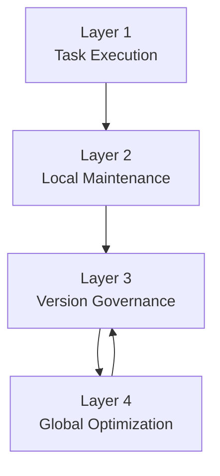

我觉得你这个判断**很有道理，而且比我前一个版本更稳**。

你担心的是：

- 如果第四层只“提建议”
- 第三层再去“照着改”
- 那中间会有语义损失
- 最后真正改出来的经验，不一定还是第四层原本想要的那个结构

这个担心我认同。  
尤其你后面第四层要做的是：

- 提纯
- 压缩
- 拆分
- 合并
- 反过拟合
- 泛化优化

这些东西本来就不是一句“建议”能说清的。  
它往往是一个**完整结构设计**。

所以我现在更推荐：

# 第四层可以直接改经验，但只能改“候选版本”，不能直接改 canonical

这就是我现在认为最合理的折中点。

---

# 先说新的核心结论

我建议把第四层重新定义成：

**Global Experience Optimizer（全局经验优化器）**

它不只是出 proposal，  
而是可以：

- 直接读取某个经验版本
- 直接在隔离的优化工作区里改出一个新版本
- 形成一个或多个候选分支 / 候选 commit
- 再交给第三层去做实验、比较、治理、晋升

也就是说：

## 第四层负责
**设计并产出候选经验版本**

## 第三层负责
**执行实验治理与版本决策**

这样信息密度就高很多，因为：

- 第四层不是“告诉别人怎么改”
- 而是“自己把候选版本改好”

这正好解决你说的那个核心问题。

---

# 这样一改，第三层和第四层的边界会更清楚

## 第三层不再负责“替第四层实现设计”
第三层不再需要理解第四层那些复杂优化意图，然后代为改经验。

第三层只负责：

- 创建和维护版本树
- 运行评测 / campaign
- 比较候选版本
- merge / promotion / discard
- 维护 canonical

一句话：
**第三层是治理层，不是创作层。**

---

## 第四层变成真正的“优化创作层”
第四层负责：

- 读历史失败模式
- 读历史 campaign 结果
- 读当前专家经验
- 读 optimizer 自己的 memory
- 直接做高层优化改写
- 生成候选经验版本

一句话：
**第四层是高层经验改造者。**

---

# 这个设计为什么比“提案式”更好

## 1. 降低语义损失
你刚才说得非常准。

如果第四层只是说：
- “建议把 A 和 B 合并”
- “建议把规则压缩”
- “建议加一套对抗样本”

那第三层要么：
- 需要自己再理解一遍
- 要么再调用别的 agent 去改

这中间一定有损失。

而如果第四层直接产出：
- 一个已经合并好的候选版本
- 一个已经拆分好的候选版本
- 一个已经压缩好的候选版本

那第三层就不需要再“翻译”第四层的设计了。

---

## 2. 第四层的能力更真实
第四层后面如果真要做：
- 规则压缩
- 结构提纯
- 经验拆分/合并
- anti-overfit

它本来就应该拥有直接编辑经验的能力。

否则它只是个“评论员”，不是真优化器。

---

## 3. 第三层职责更干净
第三层如果既要：
- 管 branch
- 管 commit
- 管 compare
- 管 merge
- 还要替第四层改经验

它会再次变成一个全能层。  
这正是我们不想要的。

---

# 但这里必须加一条硬边界

## 第四层可以改经验
**但只能改“优化候选版本”**

不能直接改：

- canonical workspace
- 当前主线 live workspace

也就是说：

### 第四层的改动目标
应该是：
- `optimizer branch workspace`
- `optimization candidate commit`

### 第四层不能直接触碰
- canonical
- 当前第二层的活动维护主线

这条边界一旦定住，系统就稳了。

---

# 重新定义第三层和第四层

我现在建议这样改。

## `Layer 3: Version Governance Layer（版本治理层）`
负责：

- 接收来自第二层或第四层的候选版本
- 建 branch / commit / candidate
- 跑 campaign
- 跑 suite
- 比较候选版本
- merge / promotion / archive
- 更新 canonical

它不设计版本内容，只治理版本命运。

---

## `Layer 4: Global Experience Optimization Layer（全局经验优化层）`
负责：

- 直接对经验版本做高层优化
- 创建优化候选分支
- 生成优化后的经验版本
- 同时维护自己的优化器经验系统

它不决定最终晋升，不直接修改 canonical。

---

# 第四层现在应该有什么输入和输出

## 输入
第四层最合理的输入包括：

- 当前专家经验版本
- 历史 campaign 结果
- 历史 branch 差异
- 失败模式统计
- augmentation / adversarial 结果
- optimizer 自己的 memory

---

## 输出
第四层不再只输出“proposal”，而是输出：

### `Optimization Candidate Package（优化候选包）`

里面应该包含：

- `base_commit`
  这个候选是从哪个版本长出来的
- `optimization_strategy`
  这次用了什么全局优化方法
- `optimizer_memory_refs`
  参考了哪些第四层内部经验
- `candidate_workspace`
  已经改好的候选经验工作区
- `candidate_diff`
  这次改了什么
- `recommended_evaluation_plan`
  建议第三层怎么测
- `expected_risks`
  预计风险点是什么

注意这里最关键的是：
**candidate_workspace 是真的已经改好的。**

这就是你想要的信息密度更高的形式。

---

# 第三层和第四层怎么交互最合理

我建议最终交互是：

## 1. 第四层直接产出候选版本
不是只写建议。

## 2. 第三层把候选版本纳入版本树
第三层收到后：
- 记成 branch 或 candidate commit

## 3. 第三层运行治理型实验
例如：
- test suite
- compare
- adversarial suite
- augmentation suite
- merge 尝试
- promotion decision

## 4. 第三层把结果反馈回第四层
不是让第四层再来“代晋升”，而是把实验结果写回第四层 optimizer memory。

这样第四层会越来越懂：
- 哪种压缩有用
- 哪种 merge 有害
- 哪种提纯容易过拟合

---

# 这样的话，augmentation / adversarial 应该放哪

这里也要重新切清楚。

## augmentation / adversarial 的“生成器”
更适合放在第四层。

因为第四层本来就在做：
- 泛化优化
- 过拟合控制

所以：
- `Augmentation Suite Builder`
- `Adversarial Suite Builder`

更像第四层的工具或子能力。

---

## augmentation / adversarial 的“执行评测”
更适合放在第三层。

因为第三层本来就负责：
- campaign
- compare
- evaluate
- promote

所以：
- 生成测试套件这件事在第四层
- 真正拿这些套件去跑分和比版本这件事在第三层

这样刚好分开：

### 第四层
设计测试

### 第三层
执行测试并治理版本

这个边界我觉得很干净。

---

# 那第二层和第四层都会改经验，会不会冲突

会有“都改经验”的表面相似，但**本质不冲突**，因为目标不同。

## 第二层改经验
是：
**局部失败驱动的局部维护**

特点：
- 来自 case / batch 的失败
- 小步
- 事务性
- 面向当前活动工作区

## 第四层改经验
是：
**全局优化驱动的高层改造**

特点：
- 来自长期评测和优化器 memory
- 大步
- 结构性
- 面向候选版本 / branch

所以：

- 第二层像“修补和增量学习”
- 第四层像“重构和泛化优化”

两者都改经验，但不是改同一个对象，也不是出于同一个触发原因。

---

# 我现在推荐的最终四层关系

解释：

- 第一层给第二层提供局部失败证据
- 第二层产出局部维护后的经验版本
- 第三层治理这些版本
- 第四层直接生成高层优化候选版本，交给第三层实验
- 第三层再把实验结果回灌给第四层

---

# 这样之后，第一版应该怎么做

现在我们不应该一下把第四层全做完。  
但必须把接口定对。

---

## `V1` 里真正要做的
### 做
- 第一层 batch kernel
- 第二层 batch maintenance
- 第三层继续最小治理
- 第四层接口正式化

### 第四层接口第一版应该包含
- `Optimization Candidate Package`
- `Optimization Outcome`
- `Optimizer Memory` 的位置定义

---

## `V1` 明确不做的
- 真正的第四层 optimizer agent
- 真正的 augmentation builder
- 真正的 adversarial builder
- 第三层复杂 merge/promotion
- 第四层大规模 branch 群优化

---

# 一句话总结

我现在认同你的判断：

**第四层不应该只是给第三层提建议，它应该可以直接把专家经验改成候选版本。**

但为了避免层次混乱，必须同时定死这条边界：

**第四层只生成候选经验版本，第三层负责治理这些候选版本的命运。**

这样：
- 第四层保住设计完整性
- 第三层保住治理稳定性
- 二者之间不会再因为“谁来翻译谁”而丢失信息

如果你认同，我下一步就可以把这一版重新整理成：
**详细的四层 V1 设计说明**  
里面会把：
- augmentation / adversarial 放哪
- 第四层怎么产出 candidate
- 第三层怎么接收
- 哪些现在做，哪些后面做

全部写清楚。