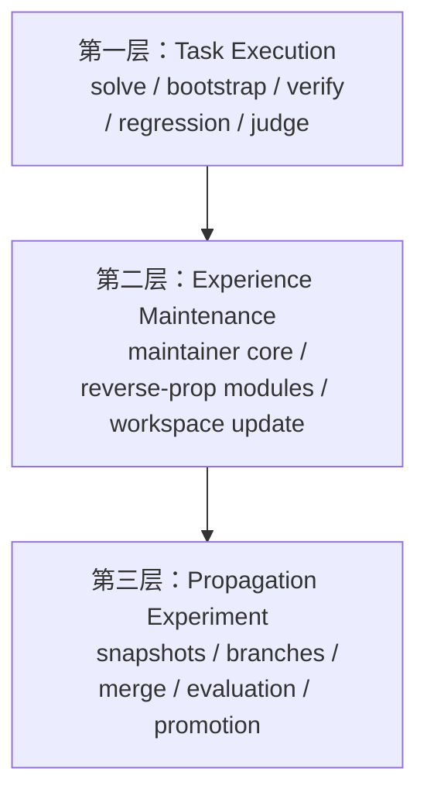
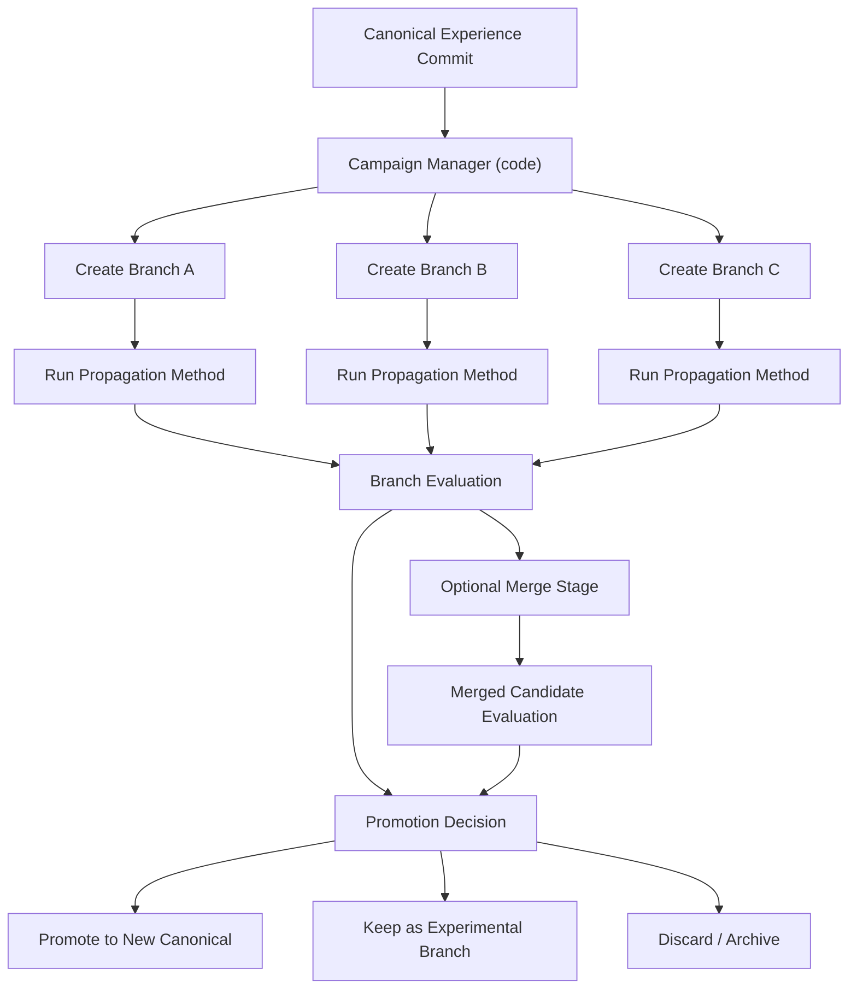

我现在的结论很明确：

**第三层一定要单独设计，而且顶层必须以代码为主控，agent 为能力插件。**  
如果让一个总 agent 去直接管理分支、合并、晋升、实验调度，后面一定会失控。

先回答你两个关键问题。

**1. 经验快照要不要全量存**
不应该全量拷贝为主，应该默认走**Git-like 增量快照**。

最合理的是 3 层表示：

- `Live Workspace`
  当前真实可读写的经验工作区。
- `Snapshot Manifest`
  一次快照只记录：
  - 文件树结构
  - 每个文件的内容哈希
  - 父快照
  - 方法、分支、评分、备注
- `Blob Store`
  真正的文件内容按哈希存一份。
  相同内容不重复存。

这样一来：
- 没变的文件不重复存
- 版本树不会爆炸
- 仍然可以随时还原任意版本
- 后面做 merge、diff、branch 都自然

所以第三层的“快照”不该理解成“复制整个目录”，而该理解成：

**一次带元数据的内容寻址提交。**

---

**2. 第三层到底该怎么放进系统**
我建议把系统固定成 3 层：

这三层边界必须清楚。

**第一层**
处理单次任务：
- 这题怎么跑
- session 做了什么
- Judge 怎么看
- 要不要启动经修

**第二层**
处理单次维护：
- 经修 agent 怎么改经验
- 用哪种反向传播模块
- 这次维护产出什么变更

**第三层**
处理长期传播实验：
- 用哪种传播方法对已有经验做新实验
- 怎么分支
- 怎么比较
- 怎么合并
- 哪个版本晋升为 canonical

---

## 第三层的正确定位

第三层不是“再跑一遍第二层”。

它处理的是：

**在已经有一套专家经验之后，如何对这套经验做真正的传播实验。**

也就是说，它面对的是：
- 经验版本
- 分支
- 方法组合
- 整体评估
- 泛化与过拟合权衡

而不是单个 case 的失败修正。

所以第三层必须包含第二层的方法，但不能等于第二层的方法。

---

## 第二层方法和第三层方法的关系

我建议分成两类。

**A. 可直接复用到第三层的方法**
这些本质上是“经验修改风格”：
- `direct-rewrite`
- `add-only`
- `section-local-update`
- `subtract-only`
- `weight-by-duplication`
- `TLR / momentum` 这种维护约束

它们在第三层里仍然成立，只是运行对象从“当前 live workspace”变成“某个 branch 上的经验快照”。

**B. 只有第三层才成立的方法**
这些本质上是“传播实验方法”：
- 对抗分支测试
- 多分支并行传播
- merge policy
- promotion policy
- sensory augmentation
- simplicity penalty
- latent shift guided rewrite
- branch-preserving / branch competition

这些方法离不开：
- 分支
- 快照
- 比较
- 晋升
- 回滚
- 合并

所以它们不能塞回第二层。

---

## 第三层最合理的核心对象

我建议现在就先把这 8 个对象定死。

**1. Experience Commit**
一次经验提交。
包含：
- 父提交
- 文件树 manifest
- blob 引用
- 生成它的方法
- 评估结果摘要

**2. Experience Branch**
一条经验演化线。
包含：
- branch 名
- head commit
- 方法来源
- 状态

**3. Campaign**
一轮完整传播实验。
包含：
- 起始 commit
- 分支集合
- 方法集合
- 数据切分
- 目标指标

**4. Candidate**
某次实验中的候选经验版本。

**5. Propagation Method**
第三层方法定义。
它不只是维护风格，还包括：
- 是否分支
- 是否 merge
- 是否多轮
- 是否带对抗
- 如何评分

**6. Evaluation Pack**
统一评估包。
包含：
- train/dev/test
- 泛化分
- 稳定性分
- 长度/复杂度惩罚
- 回归损失

**7. Merge Policy**
定义怎么把多个经验分支合并成新候选。

**8. Promotion Policy**
定义哪个 commit 可以晋升成 canonical。

---

## 第三层到底该用 agent 还是代码

我的建议非常明确：

**第三层顶层必须是代码 orchestrator。**

原因很简单：

- 分支管理必须稳定
- 实验可重复性必须高
- 评分与晋升必须可审计
- merge / promotion 不能漂
- 资源调度不能靠 agent 即兴发挥

所以第三层最好的结构是：

**代码管实验治理，agent 管语义工作。**

也就是：

### 代码负责
- 创建快照
- 创建分支
- 调度 campaign
- 运行各方法
- 汇总评分
- 执行 merge 流程
- 执行 promotion 决策
- 记录 lineage

### agent 负责
- 经修维护
- 对抗样本生成
- merge 语义建议
- branch 差异解释
- 风险分析
- 规则压缩/凝练建议

所以不是“要不要 agent”，而是：

**不能让 agent 做第三层总控，但第三层内部会用很多 agent。**

---

## 第三层我最推荐的形态

---

## 第三层和你那套 PRNN / 反向传播算法集怎么对应

我建议这样分配：

**更偏第二层的方法**
- Error-to-Edit
- Section-Local Update
- Add-Only
- TLR / Momentum
- Weight-by-duplication
- Dual-Axis 局部归因修复

**更偏第三层的方法**
- Adversarial propagation
- Sensory augmentation campaigns
- Simplicity penalty over branches
- Branch-preserving comparison
- Merge strategies
- Promotion strategies
- Latent Shift guided branch rewrite
- KV-Cache / matrix 类全局传播实验

也就是说：

**第二层更像局部学习器，第三层更像全局进化器。**

---

## 现在为了以后不返工，第二层要给第三层预留什么接口

我建议现在只需要先保证这 6 个接口思想是稳定的：

- 每次被接受的经修结果，都能导出为 `commit candidate`
- 每次经修都有结构化 `maintenance report`
- 每次评估都有统一 `evaluation pack`
- 方法定义要区分：
  - `maintenance module`
  - `propagation method`
- canonical workspace 和 experimental branch 必须分离
- merge / promotion 权限不属于经修 agent

这样前两层先跑通，第三层后面就能自然接上。

---

## 我对你现在阶段目标的建议

你刚才那句很重要：

**“我们现在的主要任务是把前序的跑完，生成真正的专家经验。”**

我同意。  
所以现在最稳的策略是：

### 当前先做的
- 第一层稳定
- 第二层稳定
- 让 `direct-rewrite` 和 `add-only` 都能持续产出可信经验
- 把 session / judge / maintainer / acceptance 这条链打磨好

### 当前先不做代码的
- Git-tree
- branch merge
- campaign orchestrator
- promotion engine

### 但现在就要定清楚设计的
- 第三层对象模型
- 第二层到第三层的接口
- canonical / branch / commit 的概念边界

---

## 一句话结论

**经验快照不该全量存，应走 Git-like 的增量内容寻址模型。**  
**第三层必须单独存在，而且必须是“代码主控的传播实验层”，内部再调用 agent 做语义工作。**  
**第二层的方法会成为第三层的子能力，但第三层一定还会拥有第二层没有的传播方法。**

如果你愿意，下一步我继续只做设计，不改代码，直接给你写一份：

**《第三层 Propagation Experiment Layer 设计说明》**

专门把：
- commit / branch / campaign
- merge / promotion
- canonical 更新规则
- 与第二层的接口

一次性讲清楚。