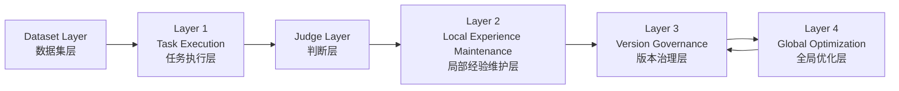

# 系统总设计文档 - 全景版

## 1. 系统是什么

这套系统不是一个“自动改提示词”的单点工具，而是一套持续演化的专家经验系统。

它要完成的事情有三类：

- 从案例里学习 `Learn from Cases`
- 把局部失败转成长期专家经验 `Convert Local Failures into Durable Expert Memory`
- 在更高层对经验版本做治理和优化 `Govern and Optimize Experience Versions`

一句话概括：

**这是一个以任务执行为入口、以经验维护为核心、以版本治理为高层容器、并为未来泛化优化预留正式接口的专家经验演化系统。**

---

## 2. 当前的总体结构

当前系统按四层理解最清楚：

同时还有一个跨层的管理平面：

- `Reverse Propagation Control Plane（反向传播控制平面）`

它不替代四层中的任何一层，而是负责统一管理：

- 反向传播组件注册
- 方法分类
- recipe 装配
- 状态通道

---

## 3. 四层分别负责什么

### `Layer 1: Task Execution Layer（任务执行层）`

回答的问题是：

- 这次任务怎么跑
- 开哪些 session
- 串行还是并行
- 每个 session 留哪些标准记录

它负责的典型入口包括：

- `bootstrap`
- `run-case`
- `run-round`
- `run-baseline`
- `run-propagation` 内部委托的局部执行

它不直接负责：

- 修改专家经验本体
- 管理版本树
- 做全局反过拟合优化

---

### `Judge Layer（判断层）`

Judge 位于第一层执行之后、第二层经修之前。

它的职责是：

- 判断当前失败是什么类型
- 判断是否值得启动经验维护
- 给 maintainer 指出重点材料和重点目标
- 在维护后判断该接受还是回滚

Judge 现在已经是前后两段：

- `Pre-Judge（前置判断）`
- `Post-Judge（后置判断）`

Judge 当前由三部分组成：

- `Runtime Guards（运行护栏）`
- `Hard Judge（硬判断）`
- `Soft Judge（软判断）`

---

### `Layer 2: Local Experience Maintenance Layer（局部经验维护层）`

这一层是当前系统的核心。

它回答的问题是：

- 一次或一批局部失败，如何变成一次局部经验更新
- 经修到底怎么改经验
- 改完如何验证、接受、回滚

这一层围绕 `Knowledge Maintainer Agent（经修代理）` 展开。

它当前已经包含：

- `Maintainer Core（维护核心）`
- `Maintenance Module（维护模块）`
- `Loading Strategy（加载策略）`
- `Maintenance Ops（维护动作）`
- `Scope Level（维护范围级别）`
- `Acceptance / Rollback（接受 / 回滚）`

---

### `Layer 3: Version Governance Layer（版本治理层）`

这一层是经验版本的治理容器。

它回答的问题是：

- 当前经验怎么快照成版本
- 如何从某个来源开出 branch
- 如何记录 candidate
- 如何组织 propagation campaign

当前第三层已经有最小治理底座：

- `commit`
- `branch`
- `candidate`
- `campaign`
- `source ref`

而且第三层已经可以直接复用下层的 local learning recipe。

第三层当前还没有完整进入：

- merge
- promotion
- multi-branch compare
- branch-preserving governance

---

### `Layer 4: Global Optimization Layer（全局优化层）`

这一层还没有正式实现，但边界已经设计清楚。

它处理的是：

- 泛化增强
- 过拟合控制
- 规则提纯
- 结构压缩
- 拆分 / 合并优化
- 全局经验重构

第四层未来可以直接产出：

- `Optimization Candidate Package（优化候选包）`

也就是说，第四层未来不是只给第三层“建议”，而是可以直接生成候选经验版本，再交给第三层去治理和评测。

第四层不直接改：

- canonical
- 当前 live 主经验线

---

## 4. 工作区模型：双平面

当前经验工作区已经采用双平面模型：

### `Tracked Experience Plane（受跟踪经验平面）`

这是正式专家经验。

包含：

- 单入口文件
- 专家 Markdown 模块
- change log
- 规则、失败教训、工具说明、输出契约
- 受控 helper assets

这一平面参与：

- diff
- rollback
- snapshot
- propagation commit
- 接受/拒绝判断

### `Runtime Sidecar Plane（运行时侧车平面）`

当前代表是：

- `.opencode/**`

这一平面允许存在，但：

- 不算专家经验
- 不参与经验 diff
- 不参与 rollback
- 不进入 commit / candidate / promotion

这个模型现在已经进入系统逻辑，也已经下沉到主要 agent prompt 的共享基础规则里。

---

## 5. Session 标准记录体系

关键 session 当前都不再只是散乱日志，而是有三份标准记录：

### `session_execution_report`

记录：

- 做了什么
- 按什么顺序做
- 哪些工具调用成功或失败
- 结果如何

### `session_learning_log`

记录：

- 本次运行中学到的东西
- 哪些行为值得后续沉淀

### `session_task_manifest`

记录：

- 这个 session 原本被要求做什么

### `task_index`

按 attempt 汇总：

- 本轮有哪些 session
- 每份主记录在哪

Judge 和 Maintainer 都主要依赖这一套标准记录体系。

---

## 6. 反向传播控制平面

当前系统已经开始引入：

- `Reverse Propagation Control Plane（反向传播控制平面）`

它不是一个新的执行层，而是跨层管理平面。

它当前负责四件事：

- `Registration（注册）`
- `Classification（分类）`
- `Composition（装配）`
- `State Channels（状态通道）`

它当前承认反向传播能力不是单一类型，而是至少分成：

### `Maintenance Module（维护模块）`

例如：

- `direct-rewrite`
- `add-only-memory`

### `Constraint Policy（约束策略）`

例如：

- `no-extra-constraint`
- 未来的 `text-learning-rate`
- 未来的 `maintenance-momentum`

### `Routing Policy（归因 / 路由策略）`

例如：

- `default-judge-routing`
- `batch-aggregate-routing`
- 未来的 `error-to-edit`
- 未来的 `dual-axis-bp`

### `Acceptance Policy（验收策略）`

例如：

- `strict-regression-guard`
- `add-only-conservative-guard`

### `Governance Strategy（治理策略）`

例如：

- `single-branch-governance`
- 未来的 `branch-preserving`
- 未来的 `merge-compare-promotion`

### `Optimization Strategy（优化策略）`

当前只保留注册位：

- `experience-compression`
- `adversarial-suite-builder`
- `sensory-augmentation-suite`

---

## 7. 当前可运行的方法与 recipe

当前真正能跑、并且已经接入控制平面的 recipe 有三条：

### `sequential-refine`

特点：

- 顺序执行
- 单 case 打包
- `direct-rewrite`
- 严格回归守卫

### `add-only`

特点：

- 顺序执行
- 单 case 打包
- `add-only-memory`
- 保守验收
- 支持一轮 attempt 内多轮维护重试

### `parallel-batch-5-add-only`

特点：

- `parallel-batch-5-light-shard`
- `batch-5-aggregate`
- 单 batch maintainer
- `add-only-memory`
- 批次级 post-judge

这些 recipe 现在已经不只是“方法名”，而是带有正式运行元数据的配方。

---

## 8. V1 批量局部学习内核

当前第一版 batch kernel 已经落地。

它的核心设计是：

**并行学习收集，串行统一维护。**

### 具体含义

不是让 5 个 case 同时改同一份经验，而是：

1. 冻结一个 batch base workspace
2. 5 个 case 并行跑 `light shard`
3. 每个 shard 只做：
   - solve
   - pre-judge
   - learning packet 抽取
4. 聚合成一个 `Batch Learning Packet`
5. 开一个 batch maintainer
6. 对这一批做一次统一维护
7. 再跑 batch 级 verify / regression / post-judge
8. 接受或回滚

这让第一层和第二层能够稳定支持小规模并发，而不会把 canonical workspace 变成并发写入战场。

---

## 9. 第三层的当前设计重点

第三层当前已经开始从“大总控脚本”往“治理流水线”收口。

它现在最关键的设计点有两个：

### `Governance Repository Plane（治理仓库平面）`

保存持久对象：

- objects
- commits
- refs
- optimization candidate metadata

### `Campaign Runtime Plane（实验运行时平面）`

保存临时实验过程对象：

- campaign runtime 目录
- branch workspace
- nested baseline / round 产物

第三层当前还加入了：

- `campaign.state.json`

这样长链实验不再只有“开始”和“结束”两个状态，而是有中间阶段状态。

---

## 10. 第四层与第三层的关系

未来第四层和第三层的边界应当保持如下：

### 第四层负责

- 直接产出优化候选版本
- 维护优化器自己的 memory
- 提出泛化优化方向

### 第三层负责

- 把候选版本纳入版本树
- 执行治理型实验
- 决定保留、淘汰、晋升、合并

也就是说：

- 第四层负责“造版本”
- 第三层负责“管版本”

---

## 11. 当前系统状态的准确判断

如果只看真实落地状态，而不是未来愿景，当前最准确的判断是：

### 已经做成的

- 第一层任务主链
- session 三记录 + task index
- pre-judge + post-judge
- 双平面工作区
- `sequential-refine`
- `add-only`
- `parallel-batch-5-add-only`
- 第三层最小治理底座
- 控制平面 V1 壳子与现有 recipe 挂接

### 已经设计但未完整实现的

- 更完整的控制平面驱动执行
- 第三层复杂治理
- 第四层优化器
- augmentation / adversarial / purification

---

## 12. 一句话总结

当前系统最准确的定义是：

**一个以任务执行为起点、以 Judge 和局部经验维护为核心、以双平面经验工作区承载专家经验、以 recipe 和控制平面组织反向传播、并以第三层版本治理为高层实验容器的专家经验演化系统。**
