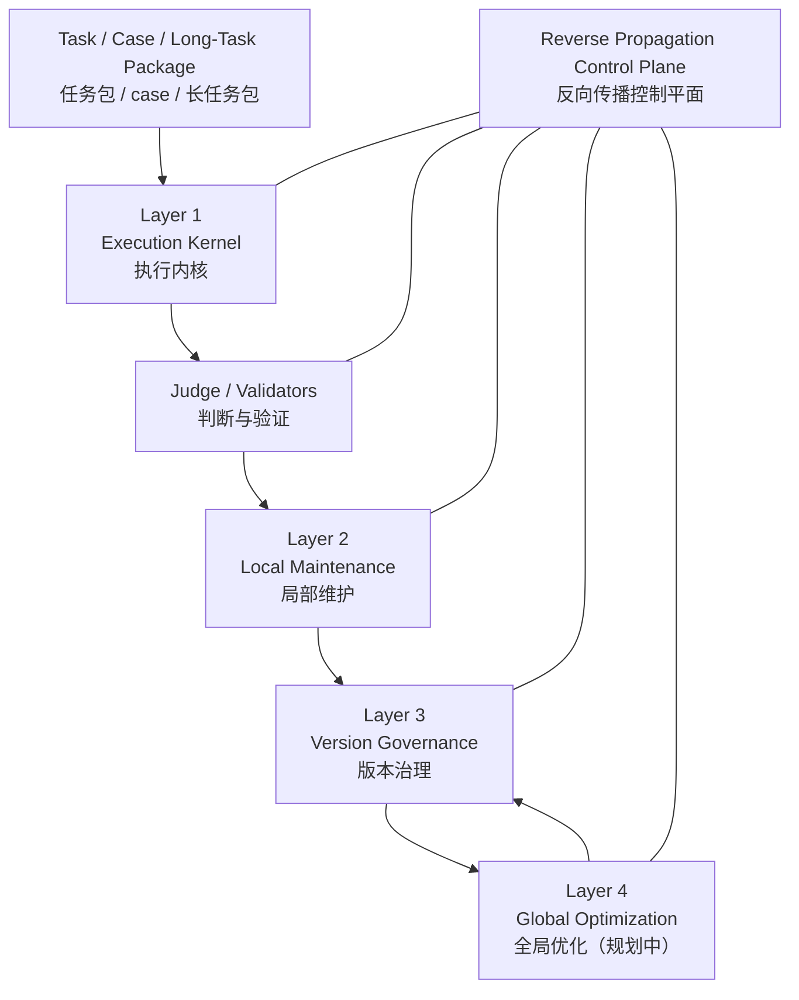

# 系统总设计文档 - 全景版

更新时间：2026-04-12

## 1. 文档目的

这份文档回答四个问题：

1. 这套系统到底是什么。
2. 现在已经真正做成了什么。
3. 各层之间怎么分工、怎么交流。
4. 后面准备往哪里继续做。

这份文档优先描述“当前真实状态”，再描述“明确的后续计划”。不把还没实现的设想写成已完成能力。

---

## 2. 系统一句话定义

这套系统不是一个单次执行工具，而是一套 `Expert Experience Evolution System（专家经验演化系统）`。

它的目标不是“让 AI 做完一次任务”就结束，而是：

- 让 AI 执行真实任务
- 用验证器检查结果
- 在失败后沉淀经验
- 在成功后保存可复用做法
- 把临时经验逐步治理成正式专家经验

它服务的最终对象不是某一次 session，而是 `Canonical Expert Experience（正式专家经验库）`。

---

## 3. 当前总架构

当前最准确的理解方式，是按“执行内核 + 维护层 + 治理层 + 优化层 + 控制平面”来看。

当前这套系统可以理解成两条已落地主线：

- `Short Task Kernel（短程任务内核）`
- `Long Task Kernel（长程任务内核）`

它们执行方式不同，但最终都服务同一个目标：

- 生成可验证结果
- 形成经验候选
- 最终进入正式专家经验治理

---

## 4. 核心设计原则

### 4.1 任务执行不是终点，经验沉淀才是终点

无论短程任务还是长程任务，系统都不把“这次跑完了”当成最终目标，而把：

- 为什么成功
- 为什么失败
- 哪些经验值得保留
- 哪些经验只是临时现象

当成更重要的输出。

### 4.2 验证优先于自述

系统不接受“agent 自己说成功了就算成功”。

必须依赖：

- `Judge（判断层）`
- `Validators（验证器）`
- `Verify / Regression（验证与回归）`

来决定结果是否真的成立。

### 4.3 运行时副产物不直接污染正式经验

系统已经采用 `Dual Plane Workspace（双平面工作区）`：

- `Tracked Experience Plane（受跟踪经验平面）`
- `Runtime Sidecar Plane（运行时侧车平面）`

正式经验和运行时副产物严格分开。

### 4.4 不是所有经验都立即升级为正式专家经验

系统当前明确区分：

- `Attempt Memory（尝试级记忆）`
- `Run Shadow Memory（运行级影子记忆）`
- `Candidate Package（候选经验包）`
- `Canonical Expert Experience（正式专家经验）`

这让系统可以“保留所有经验”，但不把所有经验都立刻写进正式库。

---

## 5. Layer 1：Execution Kernel（执行内核）

Layer 1 负责真正去“做任务”。

它当前已经不是单一执行器，而是两套执行内核：

### 5.1 Short Task Kernel（短程任务内核）

适用于：

- 单 case 学习
- 小步维护
- 快速 solve / verify / regression
- 一轮或少数几轮就能收敛的任务

当前典型链路：

`solve -> pre-judge -> maintain -> verify / regression -> post-judge -> accept / rollback`

当前已接入的典型 recipe：

- `sequential-refine`
- `add-only`
- `parallel-batch-5-add-only`

### 5.2 Long Task Kernel（长程任务内核）

适用于：

- 材料较多
- 路径不固定
- 需要多工作单元协同
- 需要边做边验证
- 需要失败后继续局部修正的任务

当前典型链路：

`plan -> work-unit execute -> validators -> retry / replan -> completion validate -> summary / shadow / candidate`

当前长程任务已经真正具备：

- 工作图生成
- 工作单元执行
- 同节点失败后重试
- retry bundle 注入失败经验
- completion validator
- run summary
- shadow memory record
- candidate package

这意味着长程不再只是“长一点的 solve”，而是独立的执行内核。

---

## 6. Judge / Validators（判断与验证）

判断与验证层现在分成两类。

### 6.1 Short Task Judge（短程判断链）

短程主线当前有完整 Judge 闭环：

- `Pre-Judge（前置判断）`
- `Post-Judge（后置判断）`

Pre-Judge 负责：

- 判断失败类型
- 判断是否值得启动维护
- 给 maintainer 提供重点材料和重点目标

Post-Judge 负责：

- 读取 verify / regression 结果
- 决定接受还是回滚
- 把失败原因反馈给下一轮维护

### 6.2 Long Task Validators（长程验证链）

长程当前主要依赖 validator 驱动，而不是短程 Judge 全链路。

当前长程有两类 validator：

- `Unit Validators（工作单元验证器）`
- `Completion Validators（收尾验证器）`

并且本轮已经补齐一个关键约束：

- `claim false` 不能再被 validator 的局部通过掩盖

也就是说，长程现在已经从“只看验证器”升级为：

- 执行自述要成立
- 验证器也要成立

两者同时满足才算成功。

---

## 7. Layer 2：Local Maintenance（局部维护层）

Layer 2 是当前系统最核心的经验反向传播执行层。

它解决的问题是：

- 一次或一批局部失败，如何变成一次局部经验更新
- 更新之后如何验证
- 验证失败如何回滚
- 验证成功如何留下经验

当前已实现能力包括：

- `Maintainer Core（维护核心边界）`
- `Maintenance Module（维护模块）`
- `Loading Strategy（加载策略接口）`
- `Maintenance Ops（维护动作接口）`
- `Scope Level（维护范围接口）`
- `Acceptance / Rollback（接受 / 回滚）`

当前已落地的维护模块包括：

- `direct-rewrite`
- `add-only-memory`

当前系统的真实状态是：

- Layer 2 已经是可运行主线
- 但它仍然主要偏“局部修补 / 增量学习”
- 还没有承担全局经验优化职责

这也是为什么后续要保留 Layer 4。

---

## 8. Long Task Memory Model（长程任务记忆模型）

这是 2026-04-12 这轮之后最关键的新状态。

长程任务现在已经不只是“执行并输出 summary”，而是形成了多层记忆结构：

### 8.1 Attempt Memory（尝试级记忆）

面向同一个 work unit 的下一次重试。

当前具体对象包括：

- `failure packet`
- `retry lesson`
- `retry journal`

作用：

- 让同一个节点失败后，下一次 attempt 真正带着失败经验再试

### 8.2 Run Shadow Memory（运行级影子记忆）

面向整轮 long-task run 的保留经验。

作用：

- 保留本轮经验
- 不直接污染正式专家经验
- 为未来同类任务提供检索基础

### 8.3 Candidate Package（候选经验包）

这是长程 run 结束后面向后续 maintainer / 治理层的正式输出。

作用：

- 让长程 run 不再只是“跑完了”
- 而是能形成结构化、可治理、可晋升的候选经验对象

### 8.4 Canonical Expert Experience（正式专家经验）

这是最终正式经验库。

当前长程已经能产出 candidate，但还没有直接接入统一 maintainer 晋升链。

---

## 9. Layer 3：Version Governance（版本治理层）

Layer 3 负责治理经验版本，而不是直接做局部任务执行。

它处理的问题包括：

- 当前经验如何快照成版本
- 如何从某个来源开出 branch
- 如何记录 candidate
- 如何组织 propagation / campaign
- 如何维护版本关系

当前已落地的基础对象包括：

- `commit`
- `branch`
- `candidate`
- `campaign`
- `source ref`
- `campaign.state.json`

当前状态可以概括为：

- 最小治理底座已经存在
- 能保存、追踪、运行实验
- 但还没做完整的 merge / promotion / branch compare

所以 Layer 3 当前是“最小可运行治理层”，还不是完整版本治理平台。

---

## 10. Layer 4：Global Optimization（全局优化层）

Layer 4 当前还没有正式实现，但边界已经基本明确。

它未来不是做局部修补，而是做高层经验优化，例如：

- 经验提纯
- 经验压缩
- 结构拆分
- 规则合并
- 反过拟合优化
- 泛化增强

Layer 4 未来最重要的设计原则已经确定：

- 它可以直接改“候选经验版本”
- 但不能直接改 canonical
- 它负责“造候选版本”
- Layer 3 负责“治理候选版本的命运”

这让 Layer 2 和 Layer 4 不会互相混淆：

- Layer 2：局部失败驱动的局部维护
- Layer 4：全局优化驱动的高层改造

---

## 11. Reverse Propagation Control Plane（反向传播控制平面）

这不是一个独立执行层，而是跨层管理平面。

它当前负责统一管理：

- `Registration（注册）`
- `Classification（分类）`
- `Composition（装配）`
- `State Channels（状态通道）`

它当前管理的主要对象包括：

- `Maintenance Modules（维护模块）`
- `Constraint Policies（约束策略）`
- `Routing Policies（路由策略）`
- `Acceptance Policies（验收策略）`
- `Governance Strategies（治理策略）`
- `Optimization Strategies（优化策略，预留位）`

当前已经真正挂上去的 recipe 包括：

- `sequential-refine`
- `add-only`
- `parallel-batch-5-add-only`

当前最准确的理解是：

- 控制平面已经不只是“命名清单”
- 已经开始成为实际 recipe 的装配与校验系统
- 但还没有完全接管三四层全部调度

---

## 12. Dual Plane Workspace（双平面工作区）

这部分现在已经是系统逻辑的一部分，不再只是设计概念。

### 12.1 Tracked Experience Plane（受跟踪经验平面）

包含：

- 正式专家经验文件
- 规则
- 输出契约
- 检查清单
- 失败教训
- 受控 helper assets

这一平面参与：

- diff
- rollback
- snapshot
- candidate / commit
- propagation / governance

### 12.2 Runtime Sidecar Plane（运行时侧车平面）

当前代表对象：

- `.opencode/**`

这一平面允许存在，但不参与：

- 经验 diff
- rollback
- commit
- promotion
- 正式治理

这条规则现在已经进入系统逻辑，并开始下沉到主要 agent 的共享基础规则中。

---

## 13. Session / Run Recording（记录体系）

当前系统已经不再只靠零散日志，而是有标准记录体系。

短程和通用记录主要包括：

- `session_execution_report`
- `session_learning_log`
- `session_task_manifest`
- `task_index`

长程当前额外拥有：

- `claims`
- `validator_results`
- `failure_packets`
- `scratch_units`
- `learning_units`
- `retry_lessons`
- `retry_journal`
- `summary`
- `candidate package`

当前这套记录体系已经足够支撑：

- Judge
- Maintainer
- Long-task retry
- 人工排查
- 候选经验保留

但未来仍需继续增强为更适合长程任务的多层记录结构。

---

## 14. 当前真实完成度

如果只看“已经真实跑通的东西”，当前最准确的判断是：

### 已经做成的

- 短程主线可运行
- Pre-Judge / Post-Judge 可运行
- Local maintainer 可运行
- Accept / rollback 可运行
- `sequential-refine` 可运行
- `add-only` 可运行
- `parallel-batch-5-add-only` 可运行
- 双平面工作区逻辑已接入
- 控制平面 V1 已接入现有 recipe
- 长程任务可真实运行
- 长程任务失败后局部重试学习闭环已接通
- 长程任务可产出 shadow memory 与 candidate package

### 已设计但未完成

- 统一学习入口
- 长短程共享 maintainer 候选摄入
- Layer 3 完整治理
- Layer 4 全局优化器
- augmentation / adversarial / purification 系列
- 更强的跨层 constraint policy
- 更长程友好的分层 session ledger

---

## 15. 明确的后续计划

### 15.1 统一入口

后续要把系统收敛成统一任务入口：

- 同一入口接收任务
- 由人类明确指定 `short` 或 `long`
- 先不做自动模式判断

### 15.2 长短程共享后续插件平面

后续共享的是：

- validator plugins
- evidence extraction
- candidate packetization
- maintainer ingestion
- governance / promotion hooks

不是强行共享 solve loop。

### 15.3 长程接入统一 maintainer 出口

长程现在已经能产出 candidate package。

下一步要做的是：

- candidate package 的统一摄入
- 让长程和短程都能进入同一个后续维护与治理出口

### 15.4 做实 Layer 3

Layer 3 后续重点：

- merge
- promotion
- multi-branch compare
- branch-preserving governance
- campaign 治理闭环

### 15.5 启动 Layer 4

Layer 4 第一版重点不是“全做完”，而是先做：

- optimizer candidate package
- optimizer outcome
- optimizer memory
- 与 Layer 3 的交互接口

### 15.6 增强长程记录体系

后续要重点补：

- raw event ledger
- tool invocation records
- 更适合长程失败复用的学习记录结构
- run 内 scratch / shadow / candidate 的更清晰分层

---

## 16. 一句话总结

当前系统最准确的定义是：

**一套以短程与长程双执行内核为入口、以验证与局部维护为核心、以双平面工作区承载专家经验、以控制平面组织反向传播方法、并正在向统一维护出口与版本治理平台演化的专家经验系统。**
